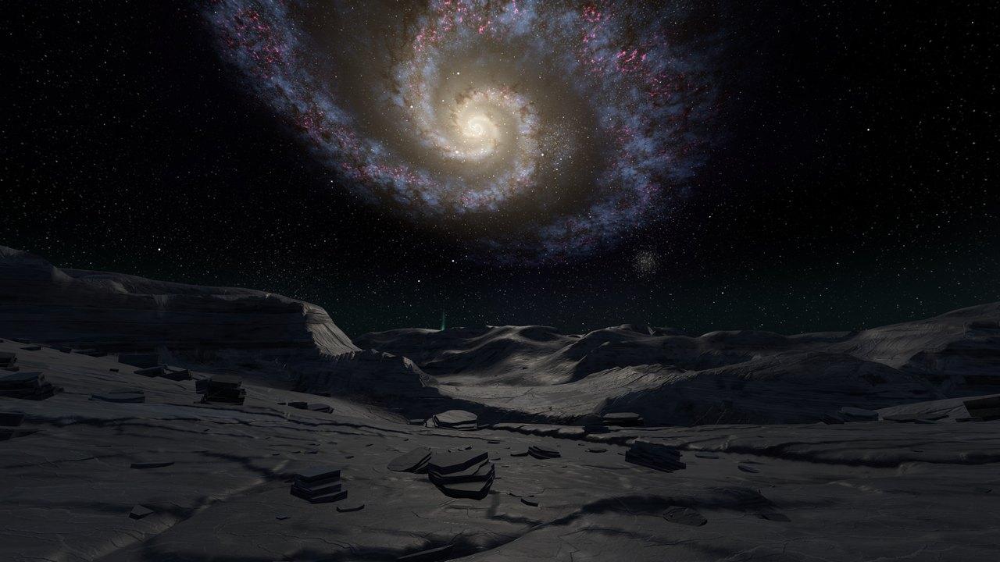
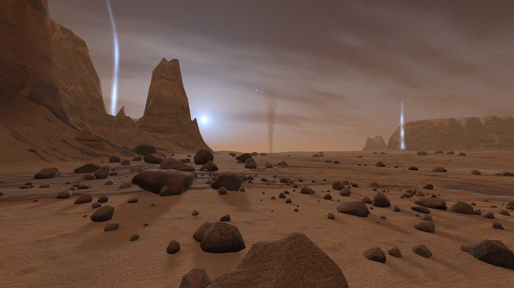

# Quest Worlds

Procedural worlds to wander through on a Meta Quest 3. There is nothing to install on the headset: it runs in the Quest Browser with WebXR, and a single number, the seed, defines an entire planet.

| Slate | Mars |
| --- | --- |
|  |  |
| Night, anthracite canyons and still water that mirrors the galaxy | Dusk, rusty dust, craters and dunes under a blue sun |

## What's in it

- **Endless ground**, computed in web workers while you walk. Canyons and layered cliffs on Slate; plains, mesas, craters from 2 m to 600 m and basalt dunes on Mars.
- **Caves** you can walk into, built with Naive Surface Nets. A plume of light marks each entrance from kilometres away.
- **A sky for every seed**, baked on the GPU while the screen is black. A rotating spiral galaxy and a drifting nebula on Slate. On Mars a butterscotch dusk with the blue glow around the sun that the rovers photographed, Phobos, Deimos, Earth as an evening star and thin ice clouds.
- **Mirror water** on Slate: the sky is drawn a second time, reflected, only on the pixels that show water.
- **Living air** on Mars: dust drifting past your head and dust devils wandering across the plains.
- **Music that never repeats:** a slow, dark ambient score synthesized live with Web Audio from the seed. No audio files, no samples and no borrowed melodies.
- **Hover mode** to fly anywhere, and a lamp for the dark.

On a real Quest 3 (Quest Browser 154) both worlds hold close to 90 frames per second.

## Try it

You need [Node.js](https://nodejs.org) 24.

```sh
npm install
npm run dev
```

Open http://localhost:5173 for a desktop preview. Choose a world in the dialog, then drag to look around and use WASD to walk.

### On a Quest

WebXR needs HTTPS, so this mode serves the page with a self-signed certificate:

```sh
npm run quest
```

Put the PC and the Quest on the same network, open `https://<IP of your PC>:5174` in the Quest Browser and accept the certificate warning. On Windows, allow Node through the firewall when it asks. Choose a world, wait until it is generated, then press **Enter VR**.

### Without a headset

`http://localhost:5173/?emulate=1` emulates a Quest 3 in the browser with [IWER](https://github.com/meta-quest/immersive-web-emulation-runtime) and shows the stereo split screen.

## Controls

| Quest | Keyboard | Action |
| --- | --- | --- |
| Left stick | WASD, drag to look | Walk |
| Right stick sideways | | Turn smoothly |
| Right stick forward/back | | Brightness, or height while hovering |
| X | N | New world on the same planet |
| Y | F | Hover on and off |
| While hovering: left stick | WASD, Space and Q | Fly where you look, faster higher up |
| Left grip | G | Jump to the next cave |
| A | O | Lamp. It turns on by itself in caves |
| B | H | Frame rate |
| Right grip | M | Music on and off |
| Meta button | | Leave VR, then choose another world |

## Addresses

| Parameter | Effect |
| --- | --- |
| `?world=mars` or `?world=slate` | Skip the dialog |
| `?seed=42` | Always the same world |
| `?music=0` | No music |
| `?cave=1` | Start in front of a cave |
| `?emulate=1` | Emulate a Quest 3 (development server only) |

## How it is built

| Part | Files | What it does |
| --- | --- | --- |
| Planets | `src/planets.ts` | What makes a world: light, curvature, view distance, tiles, rocks |
| World function | `src/world.ts` | Seed and position give the height. Runs in the worker, in the main thread and under Node |
| Windows | `src/worldWorker.ts`, `src/clips.ts` | Four clipmap windows around the head, updated row by row while you walk |
| Ground | `src/terrain.ts`, `src/clipShader.ts`, `src/shading.ts` | A quadtree of grid patches with morphing, displaced by the windows and a detail tile |
| Rocks | `src/rocks.ts` | Small stones from a scatter plan on the tile, boulders rolled per cell from the seed |
| Caves | `src/caves.ts`, `src/caveMesh.ts`, `src/caveWorker.ts`, `src/caveMeshes.ts`, `src/caveLights.ts` | Tunnels and halls, meshed in their own worker |
| Slate sky | `src/skyGen.ts`, `src/skyShaders.ts`, `src/sky.ts` | Galaxy, nebula and stars baked in time-sliced steps |
| Mars sky | `src/marsSky.ts`, `src/dust.ts` | Dusk gradient, sun, moons, clouds, dust |
| Water | `src/water.ts` | Stencil mask, reflected sky, terrain silhouettes by ray march |
| Music | `src/music.ts` | The score, composed from the seed and scheduled ahead on the audio thread |

To add a world, add an entry to `src/planets.ts`, a terrain shape to `src/world.ts`, a sky, and a set of tiles under `public/assets`.

Code comments are in German.

## Tools

```sh
npm run typecheck
npm run check          # walkability and caves, without a browser
```

| File | What it does |
| --- | --- |
| `tools/dev/preview_world.mjs` | Height map and cross section of a world as images |
| `tools/dev/check_walk.mjs`, `check_caves.mjs` | How far can you walk? Is every cave passable? Take `--planet mars` |
| `tools/dev/crack_scan.js` | Looks for holes in the terrain in the running image |
| `tools/dev/vite.trace.config.ts` | Prints what happens in the headset to your terminal, including the frame rate |
| `tools/dev/music_render.js`, `music_analyze.py` | Renders the music faster than real time and measures it |
| `tools/dev/film.js`, `film_schnitt.py` | Records a split-screen video frame by frame on scripted camera paths |

Each one explains its use at the top of the file.

### Rebuilding the assets

The tiles and rocks in `public/assets` are ready to use and contain no third-party images. To rebuild them you need Python with `numpy`, `scipy`, `opencv-python` and `pillow`, and for the slate rocks Blender:

```sh
python tools/terrain/build_terrain.py --layers meso,detail
python tools/mars/build_mars_surface.py
python tools/mars/build_mars_rocks.py
blender --background --factory-startup --python tools/blender/build_rocks.py
```

## Credits

Written by Claude (Anthropic) in Claude Code, directed by [@hf75](https://github.com/hf75). Built on [three.js](https://threejs.org) and [Vite](https://vite.dev).

## License

[MIT](LICENSE)
